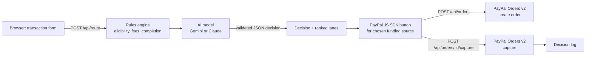

# SmartPay-Routing AI

AI checkout routing for PayPal. For every transaction, SmartPay-Routing AI decides which PayPal payment method the checkout should lead with (PayPal, Pay Later, Venmo or card), explains why, and then takes the payment through the PayPal sandbox.

Built for the [PayPal AI Hackathon](https://paypalaihackathon.devpost.com/).

- **Live demo:** _add your Render URL here_
- **Video:** _add your YouTube link here_

## The problem

Checkouts usually show every payment button in the same order for every buyer. But a returning PayPal user, a guest who won't create an account, and a shopper hesitating over a 1,300 € laptop don't respond to the same option. Showing the wrong method first costs completed sales, and fees differ between methods.

## What it does

1. **Score every method.** A transparent rules engine estimates, for each PayPal funding source, whether it is available to this buyer, its fee, and how likely the buyer is to complete payment with it. It ranks them by the merchant's goal: most revenue after fees, lowest fees, or highest completion.
2. **Let the AI decide.** A language model (Gemini by default, Claude optional) receives the same numbers plus the merchant's free-text context ("abandoned this cart twice", "corporate buyer needs a VAT invoice") and picks the method to lead with, with a confidence score and a two-sentence explanation. When it disagrees with the rules engine, the UI says so.
3. **Take the payment.** The page renders the PayPal JS SDK button for the chosen funding source. The server creates the order with the PayPal Orders v2 API and captures it after the buyer approves, all in the sandbox. Every decision and its outcome lands in a decision log.

## How PayPal is used

| PayPal product | Where | What it does here |
| --- | --- | --- |
| REST API: OAuth 2.0 | `src/paypal.js` | Client-credentials token, cached until expiry |
| REST API: Orders v2 | `src/paypal.js`, `src/app.js` | `POST /v2/checkout/orders` creates a CAPTURE order for the server-side amount; `POST /v2/checkout/orders/{id}/capture` captures it, with `PayPal-Request-Id` idempotency keys |
| JavaScript SDK (buttons + funding eligibility) | `public/app.js` | Renders a standalone button for the chosen `fundingSource` (`paypal`, `paylater`, `venmo`, `card`), checks `isEligible()` in the browser, and falls back to the next-ranked method if needed. `buyer-country` simulates the buyer's country in the sandbox |
| Pay Later, Venmo, card checkout | routing targets | The payment methods the router chooses between |

Handled edge cases: `INSTRUMENT_DECLINED` on capture restarts the PayPal flow so the buyer can pick another instrument; captures left `PENDING` (for example when the sandbox merchant doesn't accept the currency) are shown with an explanation; the order amount always comes from the server, never from the browser.

## How AI is used

`src/ai.js` sends the model a system prompt describing the routing task and a user prompt containing the transaction, the merchant goal and notes, and every method's eligibility and estimates. The model must answer with JSON:

```json
{ "fundingSource": "paylater", "confidence": 0.81, "reasoning": "..." }
```

The answer is validated: the model can only choose an eligible method, and any timeout, API error or invalid answer falls back to the rules engine, so checkout never blocks on the AI. Merchant notes are passed as data, and the prompt tells the model not to treat them as instructions.

- Default: Google **Gemini** (`gemini-3.5-flash-lite`, free tier) through the `generateContent` REST API with JSON output.
- Optional: Anthropic **Claude** (`claude-haiku-5-5`) through the Messages API.

## Architecture



## Run it locally

Requirements: Node.js 22.9 or later.

1. **PayPal sandbox credentials.** Log in to the [PayPal Developer Dashboard](https://developer.paypal.com/dashboard/), open **Apps & Credentials**, make sure **Sandbox** is selected, create an app (Merchant), and copy its **Client ID** and **Secret**.
2. **AI key.** Create a free Gemini API key in [Google AI Studio](https://aistudio.google.com/apikey). (Or use an Anthropic API key, see `.env.example`.)
3. **Configure and start:**

   ```bash
   git clone https://github.com/Eziio38/PayPal-AI-Hackathon.git
   cd PayPal-AI-Hackathon
   cp .env.example .env    # then paste your keys into .env
   npm install
   npm start
   ```

4. Open http://localhost:3000, pick an example transaction and route it.
5. **Pay.** Click the PayPal button and log in with a sandbox **personal** account. The developer dashboard creates one for you under **Testing Tools > Sandbox Accounts** (the email and password are shown there).

Without PayPal credentials the router still works and the checkout explains what's missing. Without an AI key the rules engine makes every decision.

## Deploy on Render (free)

[](https://render.com/deploy?repo=https://github.com/Eziio38/PayPal-AI-Hackathon)

The button reads `render.yaml` and asks for `PAYPAL_CLIENT_ID`, `PAYPAL_CLIENT_SECRET` and `GEMINI_API_KEY`. Manual alternative: create a **Web Service** from this repo with build command `npm ci`, start command `npm start`, and the same environment variables. Free instances sleep when idle, so the first request after a pause can take about a minute.

## Tests

```bash
npm test
```

39 tests cover the rules engine, AI response parsing and both AI providers (with mocked HTTP), the PayPal client (token caching, order body, capture, error handling), and the full HTTP flow: route, create order, capture, decision log, validation, rate limiting and the declined-card path.

## Configuration

| Variable | Required | Default | Purpose |
| --- | --- | --- | --- |
| `PAYPAL_CLIENT_ID` | for checkout | | Sandbox REST app client ID |
| `PAYPAL_CLIENT_SECRET` | for checkout | | Sandbox REST app secret (server only) |
| `GEMINI_API_KEY` | for AI | | Google Gemini API key |
| `GEMINI_MODEL` | no | `gemini-3.5-flash-lite` | Gemini model ID |
| `ANTHROPIC_API_KEY` | no | | Use Claude instead of Gemini |
| `ANTHROPIC_MODEL` | no | `claude-haiku-5-5` | Claude model ID |
| `AI_PROVIDER` | no | auto | `gemini`, `anthropic` or `none` |
| `PORT` | no | `3000` | HTTP port |
| `BRAND_NAME` | no | `SmartPay Demo Store` | Shown in PayPal order descriptions |
| `ROUTE_RATE_LIMIT` | no | `30` | Routing requests per minute per client |

## Project structure

```
index.js            server entry point
src/config.js       environment configuration (sandbox only)
src/methods.js      payment methods, eligibility tables, form options
src/engine.js       rules engine: validation, eligibility, fees, completion, ranking
src/ai.js           prompt, Gemini and Claude calls, response validation
src/paypal.js       PayPal OAuth + Orders v2 client
src/app.js          Express routes and decision log
public/             front end (HTML, CSS, vanilla JS + PayPal JS SDK)
test/               node:test suites
```

## Assumptions and limits

- **Sandbox only.** The app is hard-wired to `api-m.sandbox.paypal.com`; no real money moves.
- **Illustrative numbers.** Fees and completion rates in `src/methods.js` and `src/engine.js` are demo estimates, not PayPal's pricing or real conversion data. A merchant would replace them with their own rates and checkout analytics.
- **Pay Later availability** is modeled for the US, UK and France only. The PayPal SDK makes the final eligibility call in the browser.
- **In-memory log.** Decisions are kept in memory (last 50) and reset when the server restarts.

## Built with

Node.js, Express, PayPal REST API (Orders v2), PayPal JavaScript SDK, Google Gemini API, Anthropic Claude API, Render.

Development was assisted by Claude (Anthropic) as a coding assistant.

## License

[MIT](LICENSE)
